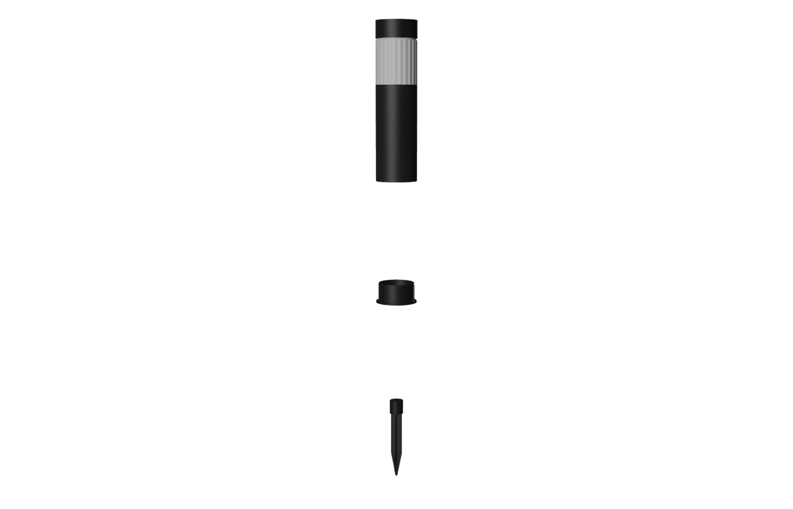
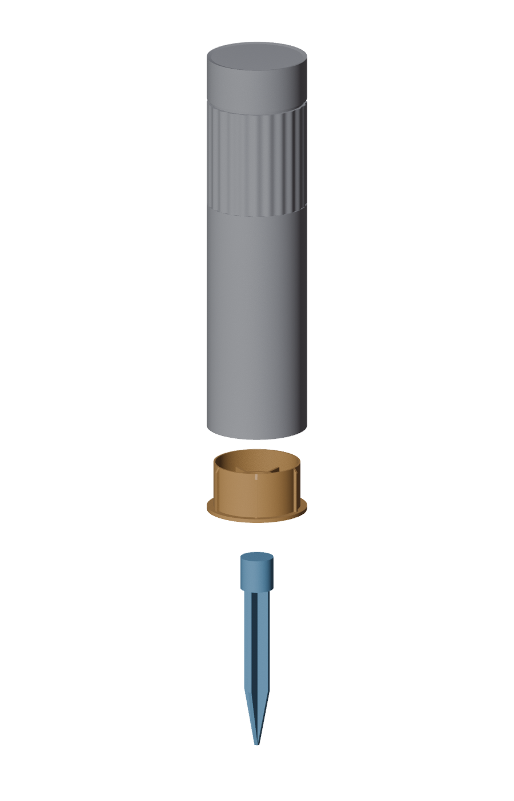
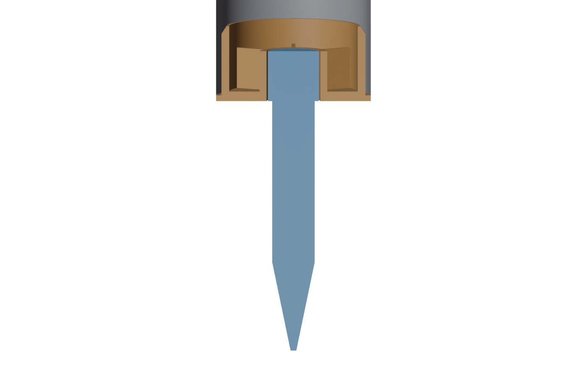

# Garden_Light_Base

Blender 3D models of garden / pathway lights, built from real product dimensions.

## Glosola_HSS1751.6PK

Model of a single light from the [Glosola Solar Pathway Lights, 6 Pack](https://www.amazon.com/dp/B0FQ2WP9CV): 35 lm, 3000K warm white, IP65.





The light is one straight cylinder made of three separate meshes:

1. **Body:** black cap with a recessed round solar panel, clear fluted acrylic lens (LED at its base), and a hollow black stainless steel pipe.
2. **Base plug:** an ABS part with a flange that the pipe rests on and a cup that goes up inside the pipe. The flange is the same diameter as the pipe, so it's flush with the outside. Six evenly spaced wedge ribs on the cup's outside grip the inside of the pipe; each has a sloped lead-in at the open end. A center socket is molded into the plug, braced to the cup wall by six evenly spaced support ribs on the floor. The socket's bore is left clear for the spike.
3. **Spike:** a one-piece ABS stake with cross-shaped fins and a round collar on top. The collar slides up into the plug's socket.

The plug and spike design comes from two photos:

- A customer photo by RReig ([image](https://m.media-amazon.com/images/I/81PO2jFwByL.jpg)). It shows a broken unit: the small loose ring in the photo is the plug's center socket, which had snapped off.
- The user's side photo of an intact plug (IMG_8570). The flange, cup height and wedge ribs were measured from it.

### Dimensions (metric, mm)

| Source | Value | Metric |
|---|---|---|
| "Measurements" → Size | 17.3" tall (incl. stake) × 3.15" lamp head | 439.42 mm × 80.01 mm |
| "Product Detail & Size" image | 3.15 in wide, 17.3 in tall incl. stake | 80.01 mm × 439.42 mm |

The assembled model measures **80.01 × 80.01 × 439.42 mm**.

The listing's "Item Dimensions" field says 3.5" × 17.3" × 3.5". The size diagram and the "Size" field both give a 3.15" diameter, so the model uses 3.15". To use 3.5" instead, change `BODY_D` in the build script.

Body part heights and the exposed spike length were measured from the size diagram. Its pixel scale is the same horizontally and vertically (3.15 in = 126 px, 17.3 in = 693 px).

| Part | z range (mm, assembled, from spike tip) | Size (mm) |
|---|---|---|
| Solar cap | 402 – 439.42 | Ø 80.01, 37.4 tall |
| Acrylic lens | 318 – 402 | Ø 80.01, 84 tall |
| Stainless pipe (hollow, 1 wall) | 133 – 318 | Ø 80.01, 185 tall |
| Base plug flange | 130 – 133 | Ø 80.01 (flush with the pipe), 3 thick |
| Base plug cup (inside the pipe) | 133 – 169 | Ø 74.41 across the rib tips (3.6 under the estimated pipe inside diameter), 36 tall |
| Spike | 0 – 156 | 26.4 wide at the modeled collar, 156 long; 130 exposed below the plug |

Plug and spike proportions were scaled from the photos, using the plug's diameter as the reference. These values are estimates (mm):

- Wall thicknesses: pipe 1, plug cup 1.5, plug floor 5
- Wedge ribs: 6 ribs, 2.5 tall (radially), 2 thick, with a 4 lead-in. The cup wall is Ø 69.41 and the rib tips reach Ø 74.41.
- Support ribs: 6 ribs, 2 thick, running from the socket's outer wall to the cup's inner wall, from the floor (5) to the top of the socket (26). They sit at 30° from the wedge ribs, midway between each pair (`INNER_RIB_OFFSET`).
- Socket: Ø 27.8 hole (`BORE_D`), Ø 34.9 outside (`SOCKET_OD`), so a 3.55 wall. The hole is set directly, so changing the wall never moves it.
- Spike collar (`COLLAR_D`): Ø 26.4 in the model. This is an old estimate, not a measurement, and it is left unmodified; it doesn't affect the plug.
- Fins: 22 across, 3 thick
- Pipe inside diameter: Ø 78.01 (`PIPE_ID`), estimated from the listing diameter and a 1 mm wall. Measure the real pipe and enter that value.
- Fit: the rib tips are 3.6 under the estimated pipe inside diameter (`RIB_CLEARANCE`, 1.8 per side), so the printed plug slides in. The hole is sized from test prints (`BORE_D`) so the stake fits.

Not modeled: the keyhole notch and molded pins on the plug floor, the notch in the cup rim, and the slots on the spike collar.

### What's in the .blend

- **Units:** Metric, length displayed in millimeters, unit scale 1.0 (true size when exported to FBX / glTF / STL). For STL, export with a scale of 1000, because slicers read STL values as mm while Blender stores meters.
- **Collection `Glosola_HSS1751.6PK`:**

  | Object | Origin | Notes |
  |---|---|---|
  | `Glosola_HSS1751.6PK` | Center of the plug's bottom face (the mating plane) | Light body |
  | `Glosola_HSS1751.6PK_Base` | Center of its bottom face | Child of the body |
  | `Glosola_HSS1751.6PK_Spike` | Spike tip | Child of the body |

- **Layout:** the file opens with the three parts lined up along the Z axis, in assembly order, with a 200 mm gap between each part's top and the next part's bottom:

  | Object | z range (mm) |
  |---|---|
  | `Glosola_HSS1751.6PK` (light) | 595 – 901.42 |
  | `Glosola_HSS1751.6PK_Base` (plug) | 356 – 395 |
  | `Glosola_HSS1751.6PK_Spike` | 0 – 156 |

  `EXPLODE_GAP` in the build script sets the gap; set it to `0` to save the light assembled. The plug and spike are parented to the body, so moving the body moves all three. To move a part on its own, clear its parent (Alt+P → Clear and Keep Transformation).
- **Watertight:** the plug and spike are each a single closed solid, ready for STL export. Zero-length slivers left by the boolean merge are dissolved in the build.
- **Materials:**

  | Material | Used on |
  |---|---|
  | `Glosola_Steel_Black` | Pipe |
  | `Glosola_ABS_Black` | Cap, plug, spike |
  | `Glosola_Acrylic_Clear` | Lens |
  | `Glosola_Solar_Panel` | Solar panel |
  | `Glosola_Module_White` | LED and solar boards inside the lens |
  | `Glosola_LED_3000K` | LED (emissive) |

### 3D printing the plug

`models/print/Glosola_HSS1751.6PK-Glosola_HSS1751.6PK_Base.obj` is the plug exported with Blender's **3D Print Toolbox** extension.

- **Units and orientation:** millimeters, Z-up, 80.01 × 80.01 × 39.00 (X × Y × Z). The plug stands flange-down, with the flange bottom at Z = 0 and its height along +Z.
- **Mesh:** 1,588 triangles, watertight.
- **Toolbox Check All:** 0 non-manifold edges, 0 intersecting faces, 0 non-flat faces, 0 thin faces (1 mm minimum), and 0 sharp edges. All 128 overhang faces are the flange bottom, which sits on the bed.
- **Orientation:** it loads flange-down in Z-up slicers, ready to print with no supports.
- **Fit (from test prints):** the first prints' ribs were too big for the pipe, so the outer wall and ribs were reduced 2 mm in radius and the hole enlarged 2 mm in radius. That went too far: the plug was about 1 mm too loose and the hole too big, so the wall and ribs went back out 1 mm in radius and the hole down 1 mm. Then the spike's lip (the thin ring at the base of its collar, see the spike photos) slid straight through the hole. The hole radius was reduced another 1.4 mm, to 12.05 mm (Ø 24.10), so the lip now stops against the plug and the collar fits tightly. After that the plug still fit too loosely in the pipe, so the ribs now stick out 3 mm from the cup wall (0.5 mm more), with the wall unchanged. With those changes the plug was too big to fit in the pipe (rib tips Ø 76.41) and the hole too small for the stake (Ø 24.10). Each size was then set midway between its last two prints: rib tips Ø 75.91 (between 75.41, too loose, and 76.41, too big) and the hole Ø 25.50 (between 26.90, where the lip slid through, and 24.10, too small). The ribs stay 3 mm tall, so the cup wall moved in 0.25 mm. The pipe is slightly out of round and can't be measured reliably, so judge the fit by test-fitting; `PIPE_ID` is only a reference. Those two sizes didn't fit either: the ribs were still too big and the hole too small for the stake. The earlier loose print (rib tips Ø 73.41, 2.5 mm ribs, hole Ø 28.90) was almost right: it needed the tips 0.5 mm bigger across and the hole 0.5 mm smaller across. So the current plug is that print with tips Ø 73.91, ribs back to 2.5 mm tall (outer wall Ø 68.91), the hole at Ø 28.40, and the socket's outside at Ø 34.90, giving a 3.25 mm socket wall. The hole is no longer sized from the spike's lip. That print was almost perfect but both fits were still a little loose, so the tips grew another 0.3 mm across (Ø 74.21, outer wall Ø 69.21) and the hole shrank 0.3 mm (Ø 28.10, socket wall 3.4 mm). The next print still had a little play on the stake and the plug was a hair loose, so the hole shrank another 0.3 mm (Ø 27.80, wall 3.55 mm) and the tips grew another 0.2 mm (Ø 74.41, outer wall Ø 69.41). If the plug is still loose or tight in the pipe, change `RIB_CLEARANCE`; if the stake is too tight or loose in the hole, change `BORE_D`. A caliper reading for `PIPE_ID` would make the clearance number meaningful.

To re-export after rebuilding, run this without `--factory-startup` so your installed toolbox loads:

```sh
/Applications/Blender.app/Contents/MacOS/Blender -b models/Glosola_HSS1751.6PK.blend \
  -P scripts/export_print3d.py -- Glosola_HSS1751.6PK_Base models/print OBJ
```

The script selects the plug, puts it flange-down at the origin, splits its faces into triangles, runs **Check All**, and then runs the toolbox's **Export**. The toolbox writes OBJ files Y-up, which is Blender's OBJ default, so for OBJ the script first rotates the plug +90° about X in the export session. That makes the file come out Z-up. It turns on the toolbox's "Scene Scale" option and sets the unit scale to 1000 for that session only, so the file comes out in mm instead of meters. Nothing is saved back to the `.blend`. Passing `STL` or `PLY` instead of `OBJ` exports those formats.

The toolbox's "Zero Faces/Edges" counts use a 0.0001 Blender-unit limit for both areas and lengths, and this model is stored in meters. That flags any face under 100 mm² and any edge under 0.1 mm, so the script prints its own counts in mm. The current export has 0 edges ≤ 0.001 mm and 0 faces ≤ 0.0001 mm².

### Files

```
scripts/build_glosola_hss1751_6pk.py   # generates the model
scripts/export_print3d.py              # 3D Print Toolbox check + export of one part
models/print/                           # print-ready exports (mm)
models/Glosola_HSS1751.6PK.blend       # generated output
models/previews/                        # preview, exploded and section renders
.claude/skills/blender3d/               # Claude Code skill + render scripts
```

## Rebuilding

Requires Blender 4.2+ (built and tested with 4.2.1 LTS).

1. Optionally edit the constants at the top of `scripts/build_glosola_hss1751_6pk.py`. They're written in **cm** (divide mm by 10); the script reports sizes in mm.
   - `TOTAL_H`, `BODY_D`: listing dimensions
   - `SPIKE_TAPER_Z`, `MATING_Z`, `LENS_Z0`, `CAP_Z0`: heights measured from the size diagram (`MATING_Z` is where the plug's bottom face sits)
   - `PIPE_ID`: the pipe's inside diameter (estimated 7.801; enter a caliper reading)
   - `RIB_CLEARANCE`: gap across the plug's rib tips under `PIPE_ID` (0.36 = 3.6 mm, set from test prints)
   - `RIB_H`: how far the ribs stick out from the cup wall. The cup wall is derived as the rib tip minus `RIB_H`, so raising `RIB_H` alone pulls the wall in. To make the ribs stick out more without moving the wall, lower `RIB_CLEARANCE` and raise `RIB_H` by the same amount.
   - `BORE_D`, `SOCKET_OD`: the plug's hole diameter (0.1 mm steps are fine) and the socket's outside diameter. The hole comes from `BORE_D` alone; `SOCKET_OD` only changes the wall thickness. `COLLAR_D` is the modeled spike collar and no longer affects the plug.
   - `PIPE_WALL`, `BASE_*`, `RIB_*`, `INNER_RIB_*`, `SOCKET_H`, `COLLAR_*`, `FIN_*`: other plug and spike sizes
   - `LENS_*`, `PANEL_*`: detail estimates
   - `EXPLODE_GAP`: gap between the parts in the saved layout (20 cm = 200 mm; `0` = assembled)
2. From the repo root, run:

   ```sh
   /Applications/Blender.app/Contents/MacOS/Blender -b --factory-startup -P scripts/build_glosola_hss1751_6pk.py
   ```

   (On other platforms, replace the path with your `blender` executable.)
3. The script overwrites `models/Glosola_HSS1751.6PK.blend`. It prints each part's dimensions, the assembled size, and the gaps in the layout. These lines should read:

   ```
   [Glosola_HSS1751.6PK] assembled dimensions (mm): X=80.01 Y=80.01 Z=439.42
   [Glosola_HSS1751.6PK] gap Glosola_HSS1751.6PK_Spike -> Glosola_HSS1751.6PK_Base: 200.00 mm
   [Glosola_HSS1751.6PK] gap Glosola_HSS1751.6PK_Base -> Glosola_HSS1751.6PK: 200.00 mm
   ```

4. Refresh the renders (the build script doesn't regenerate them):

   ```sh
   BLENDER=/Applications/Blender.app/Contents/MacOS/Blender
   $BLENDER -b models/Glosola_HSS1751.6PK.blend --factory-startup \
     -P .claude/skills/blender3d/scripts/render_preview.py -- models/previews
   $BLENDER -b models/Glosola_HSS1751.6PK.blend --factory-startup \
     -P .claude/skills/blender3d/scripts/render_fit_check.py -- models/previews
   ```

   `render_fit_check.py` also prints a non-manifold edge count for each part, which should be 0. Its exploded and section views assume the parts are assembled, so build with `EXPLODE_GAP = 0` first, then rebuild with 20 afterwards.

## Skills

`.claude/skills/blender3d/` is a Claude Code project skill (loaded automatically in this repo). It documents the modeling workflow and conventions used here (reading listing photos and size diagrams, units, naming, multi-part fits, bmesh patterns, Blender 4.2 API notes) and includes the preview and fit-check render scripts.
